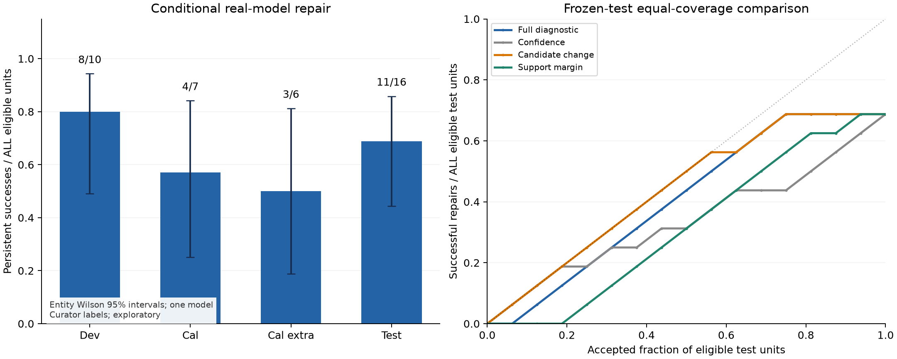
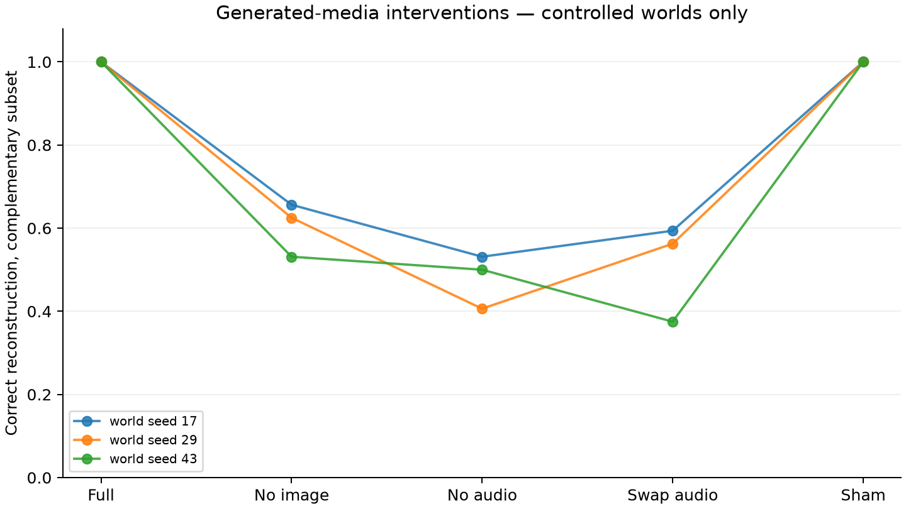

# KRMM evidence pack

Generated 2026-11-22T03:10:06.141192+08:00. Decision: **PIVOT / exploratory prototype; no G1-G3 confirmation**.

The answer-free repair prototype and controlled evaluation are implemented. No novel diagnostic, real audiovisual complementarity or paper-ready generalization has been established. All trials and failures remain in [EXPERIMENTS.md](EXPERIMENTS.md).

## Real knowledge pilot

Closed-choice acoustic-source task, one Qwen2.5-Omni-3B release, rank-8 last-four-layer updates, 48 damage / 32 repair steps, retention KL 50 and 12-prompt minibatch. Rejected and failed eligible units stay in the primary denominator.

| Cohort | Screened | Mastered | Eligible | Persistent success | Oracle | Exclusions |
|---|---:|---:|---:|---:|---:|---|
| Development | 12 | 11 | 10 | 8/10 | 10/10 | {'damage_not_local_or_not_effective': 1, 'not_stably_mastered': 1} |
| Calibration original | 12 | 7 | 7 | 4/7 | 7/7 | {'not_stably_mastered': 5} |
| Calibration extension | 12 | 6 | 6 | 3/6 | 6/6 | {'not_stably_mastered': 6} |
| Frozen test | 24 | 16 | 16 | 11/16 | 16/16 | {'not_stably_mastered': 8} |

Eligibility uses independent screen templates 4/5; diagnosis 0/1/6; updates 0/1; hidden evaluation 2/3. No target answer is supplied to repair. Calibration coverage gates failed and remain negative results; these conditional results do not establish broad population validity or G1/G2 evidence.

## Prediction and selection

Analysis status: **COMPLETE**. Eligible development/calibration/test counts: 10/13/16.

Full diagnostic versus confidence, paired entity interval: {"delta": 0.125, "ci95": [-0.25, 0.4375], "unit": "entity", "n": 16}.

Full diagnostic versus strongest calibration-selected single feature: {"delta": -0.0625, "ci95": [-0.3125, 0.125], "unit": "entity", "n": 16}.

[diagnosis.json](results/diagnosis.json) contains AUROC/AUPRC/Brier, exact coverages, all baselines and paired uncertainty. Equal-coverage selectors use identical candidates and writer outcomes, including counterfactual attempts for rejected units. An interval crossing zero does not establish improvement. The bootstrap resamples fixed per-entity selection contributions, without re-ranking each resampled batch; it is descriptive fixed-batch uncertainty. Candidate-generation gain alone is not selector gain.

## Persistence

Independent-process audit: {"n_units": 39, "all_predictions_equal": true, "max_probability_difference": 0.0, "claim_boundary": "Actual fresh process loads official base weights + merged damaged selected weights + saved adapter. No evidence is supplied at test. Only same-checkpoint functional persistence, not proof of original representation recovery."}.

A new process loads official unchanged components, complete merged damaged selected weights and each saved repair adapter. Correct and incorrect repairs can both persist. This tests functional persistence, not original parameter/representation recovery.

## Controlled evidence

Generated image/audio experiments demonstrate evidence dependence in known-rule synthetic worlds. Support-only selection matches the learned selector. Real I/O has four images and one audio source, with 5/6 correct conditions; it cannot establish real multimodal repair or sound-specific benefit.

Opposing-carrier twins, auxiliary/sham/text conditions and alternate suppression damage are separately scoped exploratory controls, not automatic G2 promotion. Their complete summaries are preserved in [reports/summary.json](reports/summary.json).

## Cost and provenance

Recorded launches: 20. Recorded aggregate child wall time: 2924.8 seconds, excluding initial downloads. Authorized whole batch: eight wall-clock hours, 20 child launches, 80GB extra storage.

Per-unit files include decoder calls/tokens, queries, peak allocated VRAM, diagnosis/training times, source SHA, configs and raw predictions. Early outer-hook counts undercounted PEFT forwards and are marked in the journal; v2 uses decoder hooks. Some serialization/verification overhead is not isolated per deployed method; no exact throughput superiority is claimed.

Pinned model commit: f75b40e3da2003cdd6e1829b1f420ca70797c34e. Source/config integrity is checked around the frozen test. A source Git bundle resolves cloud commit SHAs.

| Launch | Hypothesis | Label | Status | Seconds | Source SHA |
|---|---|---|---|---:|---|
| 1 | SYNTH1 | controlled-v1 | SUCCEEDED | 94.028 | 1f4a37c52b14f79a213156837eb357cb4cc0668f |
| 2 | SYNTH2 | controlled-v2-retry | SUCCEEDED | 108.031 | c6e5fc7925f66d8ca26af33a69211a53264970d7 |
| 3 | REAL1 | clean-screen-v1 | SUCCEEDED | 15.007 | e890f7290bd5d911214c26956bda730fec9cb0b5 |
| 4 | REAL1 | damage-repair-v1 | SUCCEEDED | 32.011 | ab0712092ae55b552e97c5464968e6004c4fba3a |
| 5 | REAL2 | retain50 | SUCCEEDED | 32.01 | 35dcca4a2d032ceab1b3dfc19e1660724e4deafc |
| 6 | REAL3 | retain50-batch12 | FAILED | 127.05 | 1c8ab5781d27d310275f7295343d51973eef29a2 |
| 7 | REAL3 | retain50-batch12-offline-retry | SUCCEEDED | 54.015 | a8242d2e961fe8f095885c2e29e892d81d45649c |
| 8 | REAL4 | damage48 | SUCCEEDED | 106.031 | d99232093328726ee896ffe03c595b71b260fca1 |
| 9 | MEDIA1 | real-media-io | FAILED | 15.006 | d99232093328726ee896ffe03c595b71b260fca1 |
| 10 | REAL5 | generic-constraints | SUCCEEDED | 107.03 | a3cf3ab790f9ceb424513248e102d76e6d90cd82 |
| 11 | MEDIA2 | media-dependency-retry | SUCCEEDED | 16.006 | 1b857f6af5478ccb08043eddd362fff428cbaaea |
| 12 | PERSIST1 | fresh-process-dev | SUCCEEDED | 19.007 | 1b857f6af5478ccb08043eddd362fff428cbaaea |
| 13 | REALV2 | v2-development | SUCCEEDED | 329.087 | 5aafa71a0f3bc69f9f836397bb72e50f4dd0d9b3 |
| 14 | CALV2 | v2-calibration | SUCCEEDED | 227.061 | ba41b4f43558fef522f523a8c6f5eee0bf8b7552 |
| 15 | CALEXT | prospective-calibration-extension | SUCCEEDED | 198.051 | a1dad59e9f2dbf22c6bcf5860bab538c9b60eb03 |
| 16 | TESTV2 | frozen-test-characterization | SUCCEEDED | 526.135 | 2361781f4f1ac5ad48b4ef2180eade715d42ec2c |
| 17 | PERSISTV2 | fresh-process-all | SUCCEEDED | 92.025 | 42d66647a2372d2a0a40b72446ddcb2dc74d232c |
| 18 | SUPPRESSV2 | alternative-suppression | SUCCEEDED | 312.086 | 42d66647a2372d2a0a40b72446ddcb2dc74d232c |
| 19 | AUXV2 | paired-media-controls | SUCCEEDED | 508.151 | 42d66647a2372d2a0a40b72446ddcb2dc74d232c |
| 20 | TWINSV2 | learned-opposing-carriers | SUCCEEDED | 7.004 | 42d66647a2372d2a0a40b72446ddcb2dc74d232c |

## Reproduction and limits

Reproduce on the cloud server with exact recorded source, model and environment in a newly authorized resource batch. Use new output directories. Never overwrite trials, bypass locks, reset gates or tune on the test. No local checkout or environment was created.

Limitations: small curator-labeled pilot requiring expert label review; exciter/resonator ambiguity; substantial screening exclusions; one real model and one damage seed; conditional entity uncertainty; limited real audio; logical audited information separation rather than OS isolation. See [BENCHMARK_AUDIT.md](docs/BENCHMARK_AUDIT.md).

The service abstains without a calibrated model, offers an explicitly uncalibrated structural baseline, reloads attempted adapters, rolls back retained-behavior violations and never certifies recovery without an independent target evaluator.

Novelty/publication status remains **PENDING**. Human scientific review is required.
