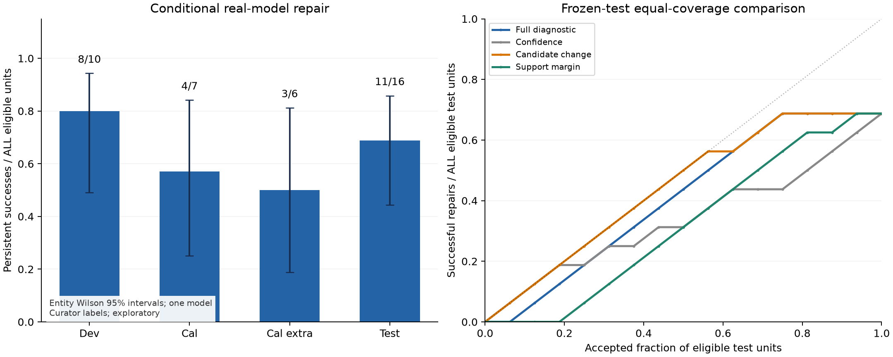

<!-- KRMM_V02_RELEASE -->
# KRMM v0.2：本批结论 PIVOT / G0 FAIL

[本批报告](docs/v2/REPORT.md) · [统一日志](EXPERIMENTS.md) · [复现](docs/v2/REPRODUCE.md)

新开发集掌握10/32；独立保留审计未支持可靠局部修复，确认性测试与真实视听阶段未启动。实现与完整失败记录保留。Built with Qwen；模型适配器许可见[Qwen研究许可](docs/v2/QWEN_RESEARCH_LICENSE.txt)和[Notice](docs/v2/Notice)。

---

# KRMM：知识可修复性诊断与选择性修复

已完成可运行的 v0.1 科研原型与 **20 次受控实验运行**。任务范围是多模态模型中的乐器声源知识；当前研究结论为 **PIVOT**，尚未获得 G1–G3 或创新性验证。

## 主要结果

| 项目 | 结果 |
|---|---|
| 真实知识规模 | 60 个不同实体；40 个通过原始掌握筛查，39 个形成合格损伤 |
| 原封存测试 | 24 个预选实体，16 个合格损伤；持久修复 **11/16（68.75%）**，监督上界 16/16 |
| 独立进程持久性 | 39 个主实验目标、117 个适配器，预测概率完全复现 |
| 复杂诊断 / 简单候选变化基线 | AUROC **0.80 / 0.90**；未证明复杂诊断的增量价值 |
| 50% 覆盖率 | 复杂诊断 7/16、置信度 5/16、候选变化 8/16；差异区间包含零 |
| 另一损伤方式 | 开发集定向抑制：6/9 合格目标修复成功 |
| 真实媒体配对对照 | 内部先验 3/4、相关媒体 2/4、置换图像 3/4、匹配文字 3/4；未显示媒体优势 |
| 显存 | RTX 3090 24GB；主流程实测峰值约 11.16GiB |

校准集、补充校准集和测试集的原始掌握覆盖率未通过预设门槛。上述修复率以**合格受损单元**为分母；失败、拒绝与筛除均保留，不能推广为全部知识的修复率。固定预算下所有正确候选均能被约束写回，因此 H3 的额外可写回性判别尚未被识别。

- [统一实验记录：每次设计、结果、分析与失败](EXPERIMENTS.md)
- [证据包](EVIDENCE_PACK.md)
- [实现与证据状态矩阵](IMPLEMENTATION_STATUS.md)
- [原始技术需求](docs/REQUIREMENTS.md)
- [冻结协议](.autoresearch/protocol.json)、[原始逐项结果](results/)、[完整运行索引](results/run-index.json)
- [数据与信息边界审计](docs/BENCHMARK_AUDIT.md)、[相关研究核查](NOVELTY_LEDGER.md)



## 实现

公开任务定义与评测真值分离。修复器只接收受损模型、实体/关系和允许证据；生成原子事实，经通用物理规则整合候选，再以最后四个语言层的 rank-8 低秩更新写回。目标正确答案只用于隔离评测、制造损伤和监督上界。

默认预算为 48 步定向错误关联损伤、32 步修复、学习率 5e-4、KL 权重 50、12 个非目标保留问题。视听编码器冻结；写回时移除辅助证据。筛查模板 4/5、诊断 0/1/6、训练 0/1、最终评测 2/3 分离。所有合格目标均执行反事实修复，以评价被拒绝样本。

真实任务主要是直接残留知识重访，不能称为已经证明组合重构。生成图像/非语言音频的受控世界验证互补信息与关键证据干预；独立学习相反随机映射后删除专用载体的双生世界验证构造中的信息不足边界。这些不能代替真实预训练知识的多模态修复结论。

## 云端复算

项目代码和环境仅位于指定云服务器与本 GitHub 仓库；没有本机项目副本或本机环境。现有云端目录：

- 项目：/root/rivermind-data/KRMM
- 环境：/root/rivermind-data/krmm-env
- 模型：/root/rivermind-data/models/Qwen2.5-Omni-3B
- 损伤权重、适配器、原始媒体：云端 results/ 与 data/media/；不将大权重或媒体二进制放进 GitHub

固定模型版本为 Qwen/Qwen2.5-Omni-3B@f75b40e3da2003cdd6e1829b1f420ca70797c34e，所有官方权重分片均已校验 SHA256。环境使用 torch 2.12.1+cu130、transformers 4.57.6；完整版本见 [environment.freeze.txt](docs/environment.freeze.txt)。下载脚本支持分段续传和完整哈希验证，代理凭据未入库。

以下仅复算统计，不调用大模型：

```bash
cd /root/rivermind-data/KRMM
PY=/root/rivermind-data/krmm-env/bin/python
$PY -m krmm.analysis results/v2-dev results/v2-calibration results/v3-calibration-extension results/v2-test --out reports/recomputed-diagnosis.json
python scripts/check_freeze.py
```

本批 20 次运行已用完。新的模型训练或修复调用属于新计算批次，需要新的明确预算，保留本批记录与原始封存集。

## 无答案修复入口

保留完整校准诊断器，并提供预注册的简单候选变化基线。入口不接收目标真值，不会自称目标恢复已被认证；违反保留约束时回滚。下面是新批次中的调用示例，使用已有的受损 flute checkpoint；保留池示例仅适用于该目标。

```bash
$PY -m krmm.simple_service --entity flute --retains configs/retain_prompts.flute.example.json --config configs/pilot-constraints.json --damaged-weight-patch results/v2-dev/c52c4fb88926/damaged_state.pt --out results/new-simple-repair
$PY -m krmm.service --entity flute --retains configs/retain_prompts.flute.example.json --config configs/pilot-constraints.json --damaged-weight-patch results/v2-dev/c52c4fb88926/damaged_state.pt --diagnosticator results/diagnosticator.joblib --out results/new-calibrated-repair
```

校准器数值参数见 [artifacts/diagnosticator.json](artifacts/diagnosticator.json)，原始逐目标预测见 [diagnosis-predictions.json](results/diagnosis-predictions.json)。其校准仅限本次条件化小样本任务，不代表通用可靠概率。

## 复现与限制

每次运行记录真实云端代码 SHA、配置、原始预测、耗时、调用/解码 token 数和显存。云端历史提交与 GitHub 发布提交不同；[source-history.bundle](docs/source-history.bundle) 保留云端源代码历史，可解析运行日志中的 SHA。

```bash
git bundle verify docs/source-history.bundle
git fetch docs/source-history.bundle refs/heads/main:refs/remotes/cloud-source/main
```

19 项命名单元测试通过，另有字节哈希、简单筛选和部署评分一致性预检。局限包括：标注需独立专家核验、激励体/共鸣体歧义、单一真实模型及损伤种子、原始掌握筛除率较高、仅一条真实音频、未做第二模型和完整训练复验。原始重载审计属于评测端操作；修复端的信息边界是逻辑与源码审计，未构建恶意程序隔离沙箱。

文献新颖性与论文级主张仍为 PENDING。全部负结果与未完成验证均公开。
