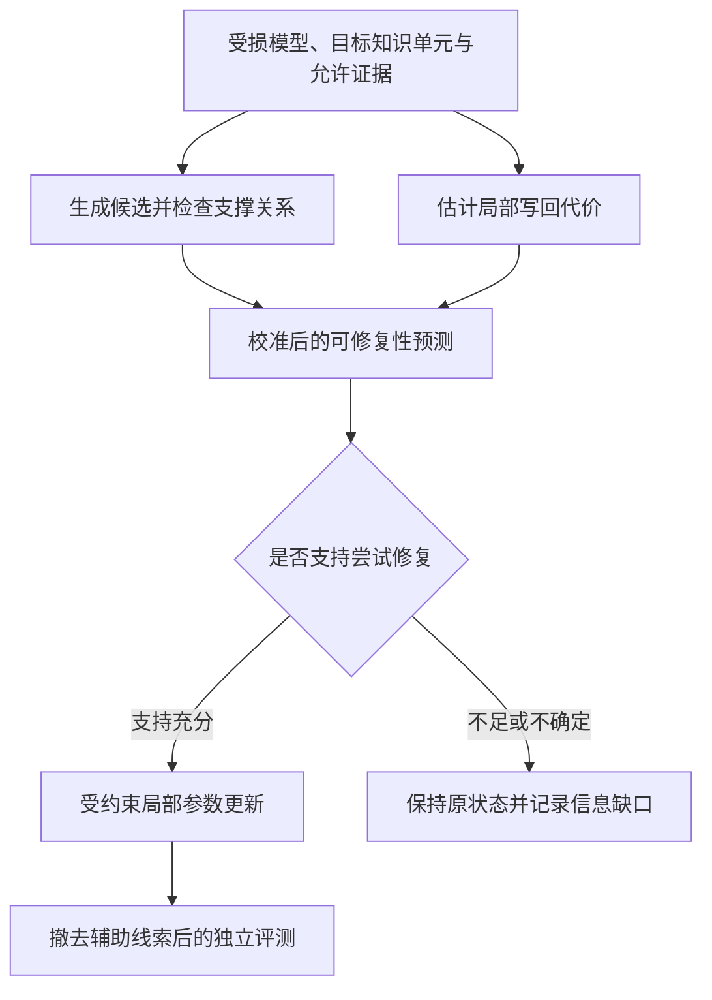

我建议把第一版明确收敛为：

> **面向多模态模型受损知识的可修复性诊断与选择性修复：在不知道目标正确答案的情况下，预测某个知识单元能否在给定预算内被持久修复，并对有充分支持的目标实施低干扰参数更新。**

第一版做两个相互配合的模块：

1. **可修复性诊断器**：判断“剩余信息能否支持正确答案，以及当前修复方法能否把它可靠地写回模型”。
2. **受约束的知识修复器**：利用保留知识重构候选答案，再通过局部参数更新恢复目标能力，同时控制对其他知识的影响。

下面给出一份可以据此组织实验的 **v0.1 方案**。其中的修复方法是具体、可实现的候选算法；目前尚未运行实验，因此“有效”是需要验证的目标，不能提前当成结论。

---

## 一、先明确研究对象与成功标准

### 1. “受损点”先定义为知识单元

第一版建议把一个受损点定义为：

\[
u=(\text{实体},\text{关系},\mathcal Q_u)
\]

其中，\(\mathcal Q_u\) 是针对同一项知识的不同问法和模态表达。

例如，一项关于某种乐器发声机制的知识，可以对应直接文本问答、图片指代问答、声音指代问答，以及相关属性的组合问题。

**第一版假定目标知识单元已经被故障测试指出。** 在整个模型中自动发现全部受损知识，可以作为后续工作。这样可以集中解决“这个已知问题能否修、如何修”，避免同时承担全模型诊断和精确神经元定位。

也不要预设“知识受损的位置就是应该修改的位置”。已有研究发现，因果追踪识别出的知识相关位置，并不可靠地指示最适合进行知识编辑的层。[proceedings.neurips.cc](https://proceedings.neurips.cc/paper_files/paper/2023/hash/3927bbdcf0e8d1fa8aa23c26f358a281-Abstract-Conference.html?utm_source=chatgpt.com)

### 2. “可修复”必须相对于信息、方法和预算定义

同一个受损点，在不同条件下可能有不同结论：

- 仅允许访问受损模型，可能无法修复。
- 允许利用相关视听线索，可能可以修复。
- 允许更新少量参数，可能无法满足保留约束。
- 增加更新范围和计算预算，可能又可以修复。

因此，第一版实际预测的是：

\[
\hat p_u
=
P\!\left(
Z_{u,\mathcal R,B}=1
\mid
\text{修复前可获得的信息}
\right)
\]

这里：

- \(\mathcal R\)：预先固定的修复算法；
- \(B\)：查询、训练步数和可更新参数的预算；
- \(Z=1\)：该修复算法在这个知识单元上成功。

成功必须同时满足：

| 条件 | 具体要求 |
|---|---|
| 目标恢复 | 在独立问题上，目标知识达到预设正确率，并明显优于受损状态 |
| 持久性 | 撤掉重构时使用的线索、清空上下文并重新加载模型后，收益仍然存在 |
| 泛化 | 收益覆盖未见问法或新媒体实例 |
| 保留性 | 应当保持的邻近知识和无关能力，下降不超过预设容忍范围 |

**有限方法没有修好，只能得到“当前方法与预算下未修复”，不能得到“任何方法都不可能修复”。**

此外，这里的“持久修复”是功能性定义，不要求参数恢复到损伤前的数值，也不声称恢复了原来的内部表示。

### 3. 将两种信息条件分开报告

这是本题最重要的实验边界之一。

| 设置 | 修复器可以使用的信息 | 能支持的研究结论 |
|---|---|---|
| **内部先验设置** | 受损模型、目标实体和关系、从同一模型提取的其他保留知识 | 从剩余内部知识进行重构与修复 |
| **无标签视听证据设置** | 上述信息，加上不直接提供目标标签的图像和声音 | 无目标标签的证据辅助修复 |

第二种设置即使没有文字答案，也引入了新的目标相关信息，不能描述为“完全不接触目标信息”。

我建议**保留两条实验线，先用第二条跑通完整流程，再单独验证第一条能做到什么**。两种设置都不能给修复器提供干净模型、原模型正确回答、目标真值或损伤前后的参数差值。

---

## 二、第一版的四个待验证猜想

核心猜想可以概括为：

> **受损知识能否被修复，至少受到三个不同因素约束：答案是否可辨识、保留知识是否可访问、正确关联是否可以低干扰地写回。**

这三个因素需要分别测量，不能先人为给三个分数，再直接相乘当成修复概率。

### H1：剩余证据结构比直接回答的置信度更能预测修复成功

**猜想：**在受损程度和预算相近时，候选答案是否得到完整约束支持、是否存在冲突、是否依赖真实有效的证据，比模型直接回答的概率或多次回答一致率，更能预测修复结果。

例如，模型可能非常自信地重复被污染的答案；但其他保留关系与该答案相冲突。这样的目标不应因为“置信度高”就被直接写回。

**验证方式：**

比较完整诊断器与以下简单预测器：

- 直接答案置信度；
- 输出熵；
- 多次回答一致率；
- 跨模态一致率；
- 最强单项诊断特征。

**否证条件：**在独立实体上，完整诊断不能超过上述简单基线；或者收益仅来自更多查询和推理 token。

### H2：支撑重构的关键知识路径具有可干预的作用

**猜想：**如果某个候选答案确实依赖一条保留知识路径，那么切断该路径中的决定性信息，会降低候选正确率和最终修复成功率；修改无关信息不会产生同样影响。

这里可以使用一个受控例子：

- 保留事实：实体 \(X\) 具有视觉属性 \(a\)。
- 保留事实：实体 \(X\) 具有声音属性 \(b\)。
- 保留规则：同时具有 \(a,b\) 的实体属于类别 \(c\)。
- 被破坏的知识：\(X\) 属于类别 \(c\)。

然后比较完整信息、缺少视觉属性、缺少声音属性、替换无关属性等条件。

**否证条件：**关键路径删除和无关路径删除影响相同；或者模型始终输出原来的候选，不随决定性证据变化。

这比让模型写出一段“我为什么这样推理”的解释更有证据力。

### H3：答案能够重构，不意味着能够低干扰地写回

**猜想：**在候选答案已经正确的样本中，参数更新与保留任务之间的冲突程度，仍然能够解释修复成败。

可能出现：

- 候选正确，但局部更新不足以让模型在撤掉证据后回答正确。
- 目标修好了，但相近实体的知识被同时改变。
- 同样正确的候选，在不同更新位置具有不同的保留代价。

**否证条件：**写回冲突指标没有额外预测价值；或者其作用完全可以由直接答案置信度解释。

注意，候选是否正确仅由评测端事后判断，用来分析机制；这个标签不能进入测试时的诊断器。

### H4：诊断筛选与受约束写回能够提高有效修复数量

**猜想：**在相同信息、相同覆盖率或相同总预算下，先诊断再修复，比无筛选自训练、置信度筛选自训练取得更好的持久恢复与保留性权衡。

**否证条件：**

- 收益只存在于带辅助证据的输入中。
- 修复仅记住训练问法。
- 大量拒绝样本之后，虽然接受样本的成功率提高，但整体成功修复数量没有改善。
- 普通自蒸馏加保留约束已经解释了全部收益。

这条猜想决定我们最终能否提出一套有实际价值的方法。

---

## 三、诊断框架：分别判断“知道该修成什么”和“能否写回”

整体结构如下：

### 1. 信息可辨识性：剩余知识能否确定答案？

先从允许的信息中构造一个小型支撑结构，记录：

- 哪些原子事实支持哪个候选；
- 哪些规则把原子事实连接到目标；
- 哪些候选仍然无法排除；
- 哪些证据互相冲突。

对于受控合成任务，可以明确计算：

\[
\mathcal Y_u(K)
=
\left\{
y:
y \text{ 与允许使用的保留知识 } K \text{ 一致}
\right\}
\]

如果 \(\lvert\mathcal Y_u(K)\rvert=1\)，说明在所定义规则下，答案可被唯一确定；如果存在多个候选，就有信息歧义。

对于真实知识，通常无法列出完整约束。因此这里得到的是**经验性的支持程度**，不是形式化正确性保证。

第一版可采用的特征包括：

| 特征 | 想测量什么 |
|---|---|
| 尚未排除的候选数量 | 是否存在明显歧义 |
| 支撑链是否完整 | 是否缺少决定性前提 |
| 支撑事实之间的冲突率 | 是否存在相互矛盾的先验 |
| 删除关键证据后的候选变化 | 模型是否真的依赖该证据 |
| 替换无关证据后的稳定性 | 是否只是被输入扰动影响 |
| 来源重叠程度 | 多条“证据”是否来自同一个错误来源 |

**同一模型的多个提示、多个模态输出，并不天然构成独立证据。** 它们可能受同一段共享语言参数影响，一致地答错。

### 2. 计算可达性：有这些知识，模型能不能用起来？

信息足够，并不意味着模型能够完成所需推导。

第一版用固定预算做结构化探测，例如依次检查：

1. 能否正确提取视觉或声音中的原子属性。
2. 能否回答与目标不同的相关关系。
3. 能否把这些关系组合成候选答案。
4. 在关键证据改变时，候选是否按预期变化。

这里应保存可检查的原子事实与候选，而不是将长篇推理文本本身当作正确性证据。

诊断只能发生在参数更新之前。所有诊断调用都计入成本，不能用几十次探测得到的结果去对比一次直接问答，然后把差异全部归因于框架。

### 3. 低干扰可写回性：候选正确时，修改代价多大？

这一部分可以先从一个轻量指标起步：

> 候选答案所要求的更新方向，与保留任务所要求的稳定方向之间，冲突有多大？

更正式地，设 \(z\) 是允许更新的局部参数，\(g_u\) 是候选答案损失对 \(z\) 的梯度，\(H_R\) 近似描述保留任务对参数变化的敏感度。在局部线性近似下，可以考虑：

\[
\min_{\delta z}\ \delta z^\top H_R\delta z,
\qquad
\text{s.t. }g_u^\top\delta z\le -m
\]

它表示：为了让候选答案损失至少下降 \(m\)，最少需要承担多大的保留代价。

当 \(H_R\) 正定时，该近似问题的最小代价为：

\[
C_u=
\frac{m^2}{g_u^\top H_R^{-1}g_u}
\]

第一版可以用对角 Fisher 近似或更简单的梯度冲突指标，避免构造完整矩阵。

**这个量只评估“把当前候选写进去”的局部难度，不证明候选正确，也不保证非线性训练最终成功。** 它是否有用，正是 H3 要验证的内容。

### 4. 最终用简单模型预测，允许拒绝判断

建议先用带正则的逻辑回归，把以上特征映射为固定修复器的成功概率。

诊断器可以在其他独立知识单元上学习“哪些特征对应修复成功”，所以它不是完全无监督系统；要求是**测试目标的正确答案和修复结果不可见**。

输出可以包括：

- 预测修复成功概率；
- 当前候选答案；
- 主要支撑关系和冲突；
- 预计写回风险；
- 建议尝试、信息不足，或暂不确定。

如果在修复之后才根据实际表现输出“可修复”，就失去了事前诊断的意义。

---

## 四、第一种候选修复办法：受约束重构与局部写回

我建议把它作为第一版的固定修复器，不急着增加复杂网络。

### 步骤 A：从保留路径生成候选答案

针对目标关系，提取其他仍可访问的知识，并在允许的设置下利用图像或声音。

需要把候选分为两类：

- **直接残留**：其他路径直接给出了同一答案。
- **组合重构**：其他路径提供不同事实，需要组合后才能得到答案。

两类都可以用于修复，但必须分开报告。只有第二类能直接支持“通过其他先验重构目标知识”的核心主张。

### 步骤 B：验证候选是否有足够支持

在有限候选中检查：

- 是否有完整的支撑链；
- 是否存在无法排除的其他答案；
- 关键证据移除后，支持是否合理下降；
- 是否存在跨路径矛盾；
- 多条支持是否只是重复了同一信息。

满足在校准集上确定的条件，才产生伪标签 \(\hat y_u\)。否则保持原模型状态。

为了避免错误自我强化，**第一版只进行一轮重构和写回**，不让模型反复用自己刚写入的答案重新证明自己正确。

### 步骤 C：撤掉辅助证据，进行局部参数更新

写回训练时，输入只保留目标问题或正常任务输入，撤掉重构时额外提供的支撑事实。

可以采用：

\[
\begin{aligned}
\mathcal L_{\mathrm{repair}}
=&\
\mathbb E_{q\in\mathcal Q_u^{\mathrm{train}}}
\left[
-\log p_{\theta_d+\Delta}(\hat y_u\mid q)
\right]\\
&+\lambda
\mathbb E_{x\in D_{\mathrm{retain}}}
D_{\mathrm{KL}}
\left(
p_{\theta_d}(\cdot\mid x)
\Vert
p_{\theta_d+\Delta}(\cdot\mid x)
\right)\\
&+\mu\|\Delta\|_2^2
\end{aligned}
\]

三个部分分别要求：

1. 将重构出的关联写入参数。
2. 尽量保持非目标任务的原有行为。
3. 限制更新幅度。

第一版冻结视听编码器，只更新开发阶段选定的少量语言层或融合相关参数，使用低秩更新降低成本。

这里的保留教师是**受损模型在非目标范围内的表现**，不能偷换成干净模型。

另一个容易忽略的问题是：**保留集不能把应该随目标一起改变的逻辑后果也冻结住。** 如果修复某条事实理应改变相关推论，这些推论应进入目标一致性测试，而非作为“不许改变”的保留样本。

### 步骤 D：按预先规定的规则停止

在开发集选定并冻结：

- 更新层范围；
- 低秩参数规模；
- 学习率和最大步数；
- 保留损失权重；
- 更新范数上限；
- 回滚条件。

测试时不能看隐藏答案挑选最好的 checkpoint。允许使用的停止依据，应限于预先规定的训练条件、保留集行为变化或更新幅度。

### 步骤 E：独立验证持久修复

完成更新后：

- 清空上下文；
- 去掉辅助证据；
- 重新加载修复后的参数；
- 测试未见问法、新媒体实例和相关关系；
- 检查相近实体及无关知识。

对于原本就是图像或音频输入的任务，测试仍保留其正常输入，只撤掉修复阶段额外使用的辅助材料，不能为了“去掉证据”把任务本身变成不可解。

**只有这里通过，才能说获得了持久的功能性修复。**

---

## 五、实验设计：真实知识与受控世界承担不同任务

### 1. 真实知识集：证明方法具有实际意义

先选容易核实、又有视觉和声音关联的关系类型，例如：

- 常见乐器的类别、结构与发声机制；
- 常见声源与其产生声音的机制；
- 同时具有可观察外观与声学属性的实体关系。

每个知识单元需要有独立真值、多个问法，以及来源分离的媒体样本。

流程应当是：

1. 先划分开发、校准和最终测试实体。
2. 由评测端确认原模型在独立筛选问题上稳定掌握目标。
3. 使用冻结的损伤程序制造退化。
4. 确认目标能力下降，而相关基础能力和无关能力仍可用。
5. 将受损模型和允许的信息交给诊断与修复程序。
6. 使用另一组封存问题评测。

必须报告原始掌握率、损伤成功率和排除率。否则只展示容易修复的成功案例，会高估方法能力。

### 2. 受控合成集：区分恢复机制和信息边界

建议构造四类任务：

| 类型 | 剩余信息 | 主要用途 |
|---|---|---|
| 直接冗余 | 另一条路径保留相同答案 | 测残留知识重新访问 |
| 互补推导 | 不同事实单独不足，组合后足够 | 测真正的组合重构 |
| 信息歧义 | 多个答案都符合剩余信息 | 测是否能够拒绝不可靠写回 |
| 随机关联 | 目标与剩余属性无关 | 测是否把猜测误认为恢复 |

合成知识需要先被模型学习，因此它只能支持受控机制结论，不能替代真实预训练知识的实验。

#### 一个特别有力的负对照：双生世界

构造两个原始模型，让它们学会相反的随机目标映射。随后删除全部承载这部分映射的专用注入参数，使两个受损模型的权重完全相同，允许提供的证据也完全相同。

此时：

- 修复器看到的输入相同；
- 两个世界的正确答案不同。

任何修复算法都无法保证在两个世界中同时恢复正确答案。这能明确展示：**信息不存在时，诊断器应该承认边界。**

但这只是合成构造中的信息不足证明，不能外推为“真实预训练模型中的知识已经彻底删除”。

### 3. 损伤方式：先污染，再扩展到遗忘

第一轮优先做**定向错误关联编辑**，因为损伤目标比较清晰：将正确关联改成错误关联，同时尽量保持其他能力。

第二轮增加一种独立的定向遗忘或抑制方法，检验诊断是否能跨损伤机制泛化。

必要控制包括：

- 未受损模型；
- 等预算的无关知识编辑；
- 随机扰动参考；
- 相关、无关与置换后的媒体；
- 信息量匹配的文字说明；
- 由评测端提供真值的监督修复上界。

污染更新应当合并进交付给修复器的模型，修复器不能通过关闭损伤适配器或减去已知参数差值完成恢复。

如果连监督真值上界都修不好，应先检查更新范围、优化和预算，不能直接认定“剩余先验不足”。

### 4. 声音必须提供实际信息

要专门构造或筛选一个互补子集：

- 视觉单独有歧义；
- 声音单独有歧义；
- 二者结合能消除部分歧义。

优先使用非语言声音，避免音频只是把答案念出来。

同时比较真实音频与信息匹配的文字描述。如果两者效果相同，可以支持“声学语义信息有帮助”，但不足以证明存在特殊的跨模态修复机制。

---

## 六、怎样评价诊断和修复，避免得到虚假的高分？

### 1. 将诊断收益与修复算法收益分开

最重要的比较是：**保持候选生成和写回算法相同，只改变是否修复的判断方法。**

| 基线 | 排除的简单解释 |
|---|---|
| 不修复 | 自然波动或原模型残留能力 |
| 同证据的结构化推理，不更新参数 | 即时输入补偿 |
| 不筛选的伪标签写回 | 任何自训练都能改善 |
| 置信度筛选后写回 | 简单置信度足够 |
| 一致性筛选后写回 | 多次投票足够 |
| 同覆盖率随机选择后写回 | 只挑少量样本造成高成功率 |
| 完整诊断后写回 | 检验框架的增量价值 |
| 真值监督写回 | 判断当前编辑器的可实现上界 |

还要做一次固定候选集的比较：让不同写回算法使用完全相同的伪标签，才能区分“候选更准”和“编辑更好”。

### 2. 主要指标

诊断侧建议报告：

- 修复成功预测的 AUROC、AUPRC；
- Brier score 或校准曲线；
- 接受覆盖率与实际失败率的关系；
- 预测可修复但实际失败的比例。

修复侧建议报告：

- 撤掉辅助证据后的目标准确率；
- 持久修复成功率；
- 邻近知识与无关能力变化；
- 错误答案扩散率；
- 每个成功修复的总计算成本。

**主要方法指标建议使用：在固定总预算和保留约束下，全部合格受损知识单元中，成功修复的比例。**

拒绝修复的样本也在分母里。这样不能通过只接受极少数容易样本制造好成绩。

### 3. 不能只评估被接受的样本

为了知道诊断器是否错误拒绝了本来能够修复的目标，评测端需要在隔离副本上，对接受和拒绝的样本都执行同一个固定修复器，获得真实结果。

这些结果只能用于事后评价，不能回流给测试时的判断。

否则我们只能知道“接受样本修得怎样”，无法知道诊断器是否有用。

### 4. 数据隔离与统计单位

开发、校准和测试应按实体或合成世界划分；同一实体的不同问法、图片、音频不能跨集合泄漏。

同一知识单元的十种改写不是十个独立样本。置信区间应按实体、源媒体或知识图子结构聚类；同一损伤 checkpoint 影响多个事实时，也要考虑损伤批次带来的相关性。

---

## 七、单卡条件下的实施顺序与停止条件

沿用你此前的单卡资源约束，第一版可以暂按 **24GB 级显存预算**设计，但需要先实测峰值。

首个候选模型可以用 **Qwen2.5-Omni-3B**。官方仓库确认它支持文本、图像、音频输入，并支持关闭语音输出。官方视频推理显存数据也明确提示实际用量可能高于理论值，因此不能据此保证单卡训练一定可行。[GitHub](https://github.com/QwenLM/Qwen2.5-Omni?utm_source=chatgpt.com)

建议起步配置如下，数值均是待开发集验证的初始配置：

| 项目 | v0.1 建议 |
|---|---|
| 模型 | 一个小型开放权重全模态模型 |
| 媒体 | 单张图片、数秒非语言音频 |
| 输出 | 只生成文本 |
| 更新范围 | 冻结视听编码器，少量语言层低秩更新 |
| 诊断预算 | 每个知识单元固定上限，例如 24–32 次调用 |
| 写回预算 | 固定低秩规模、最多数十步短序列更新 |
| 第一轮规模 | 约 30–60 个真实知识单元，加小型受控机制集 |
| 实验方式 | 先单个知识单元独立修复，再考虑批量修复 |

30–60 个实例用于判断流程是否值得继续，不能当作正式统计规模。正式样本量应依据探索阶段的效应、接受率和方差确定，并使用新的封存测试集。

### Gate 设计

| Gate | 要回答的问题 | 继续或停止依据 |
|---|---|---|
| **G0：有效性与可行性** | 原模型会不会？损伤是否局部？监督上界能否写回？单卡能否完成流程？ | 任一关键条件不成立，先修任务或实现 |
| **G1：机制与方法价值** | 有无可信候选？是否持久恢复？诊断是否胜过最强简单基线？ | 若只有上下文补偿，不能进入持久修复主张 |
| **G2：泛化** | 新实体、另一种损伤方式和不同模型是否仍成立？ | 不成立时收窄结论，不隐藏失败 |
| **G3：冻结复验** | 固定配置能否重现？独立测试、保留约束和成本是否完整？ | 达成后再形成论文主张 |

第一轮最应优先验证的是：

> **在目标真值不可见的条件下，能否产生足够可靠的候选，并让最简单的局部更新在撤掉证据后仍然有效？**

如果这一步失败，先不要训练复杂诊断网络；它会在一个没有稳定修复能力的系统上预测噪声。

---

## 八、创新性应当放在哪里？

本次重新检索发现，相关空间比“遗忘之后能恢复”更加拥挤，需要明确对照：

| 邻近研究 | 已经覆盖的内容 | 我们需要证明的进一步价值 |
|---|---|---|
| **J-Access，2026 预印本** | 用修复前内部可达性预测模型整体的恢复速度和幅度；作者明确报告具体事实级预测不成立 | 在同一受损模型内部，预测具体知识单元的持久修复结果，并限制目标真值的使用。[arxiv.org](https://arxiv.org/abs/2608.11408?utm_source=chatgpt.com) |
| **Predicting Success of Model Editing via Intrinsic Features，COLM 2025 INTERPLAY Workshop** | 利用内部特征和原输出概率预测编辑效果 | 在不知道应写入什么答案时，同时解决候选可靠性与可写回性。[INTERPLAY](https://interplay-workshop.github.io/accepted-papers.html?utm_source=chatgpt.com) |
| **CLaRE，Findings ACL 2026** | 根据表示纠缠预测知识编辑的连带影响 | 将副作用判断与无目标真值的重构、选择性修复联合评估。[ACL Anthology](https://aclanthology.org/2026.findings-acl.1469/?utm_source=chatgpt.com) |
| **Self-Distillation Enables Continual Learning，ICML 2026** | 用带示范上下文的自身作为教师，通过自蒸馏学习并减少遗忘 | 证明剩余知识生成的候选何时可信，以及事前诊断能否改善实际修复。[proceedings.mlr.press](https://proceedings.mlr.press/v306/shenfeld26a.html?utm_source=chatgpt.com) |
| **TMKE，ICCV 2025** | 研究单模态知识编辑向多模态的迁移 | 证明视听互补证据对重构与诊断的必要作用，而不仅是文本编辑后跨模态分数提高。[openaccess.thecvf.com](https://openaccess.thecvf.com/content/ICCV2025/papers/Fang_Can_Knowledge_be_Transferred_from_Unimodal_to_Multimodal_Investigating_the_ICCV_2025_paper.pdf?utm_source=chatgpt.com) |

所以，**“自蒸馏＋LoRA”“预测编辑成功”“跨模态恢复”都不能单独作为创新点。**

这版最值得验证的贡献是：

> **在目标真值不可见时，将“剩余信息是否支持正确重构”与“正确关联能否低干扰写回”分开建模，形成事实级、可拒绝的修复决策，并通过关键证据干预解释决策为什么成立。**

第一轮应产出三项实证结果：候选正确率与覆盖率、无辅助证据的持久修复率、以及诊断相对简单置信度的增量价值。三项都成立，才值得扩展模型和数据规模；其中任何一项不成立，都能清楚指出应当修改哪一部分假设。

**当前状态：v0.1 技术路线已明确，实验尚未执行，G0–G3 均未取得通过证据。**